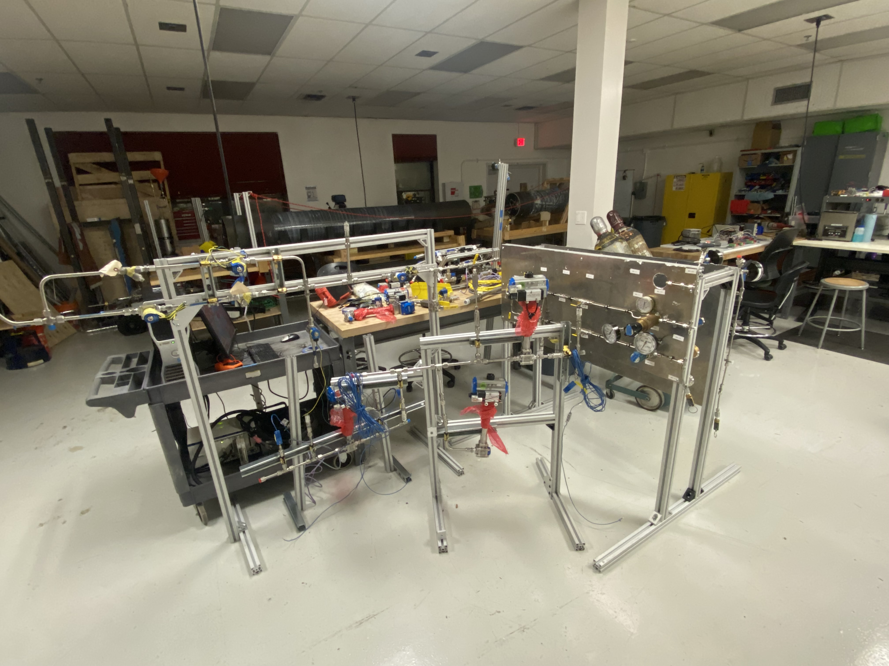
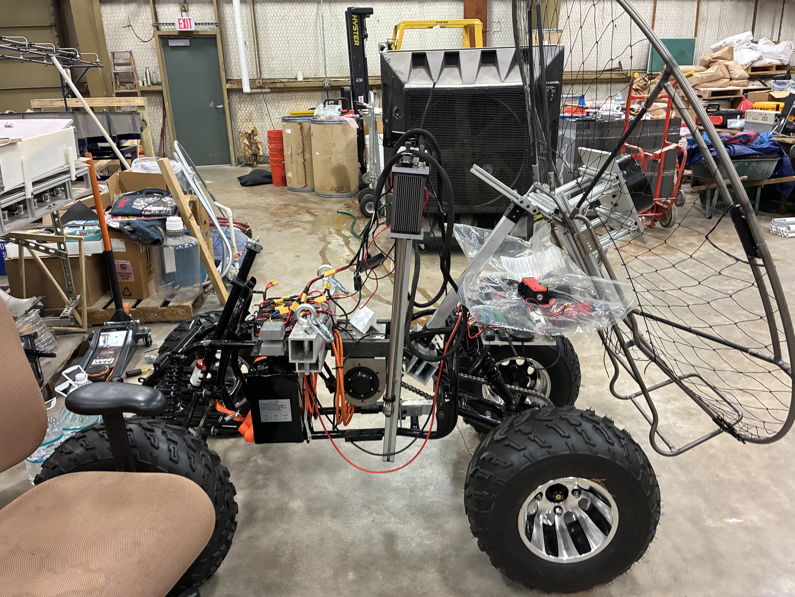
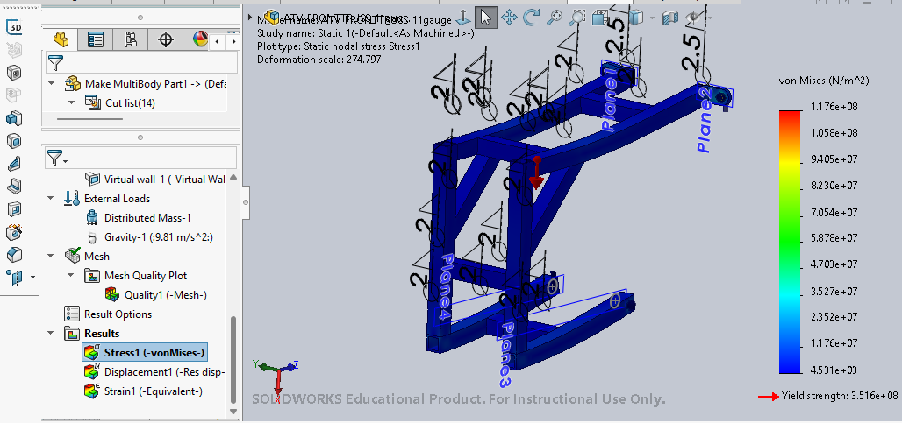
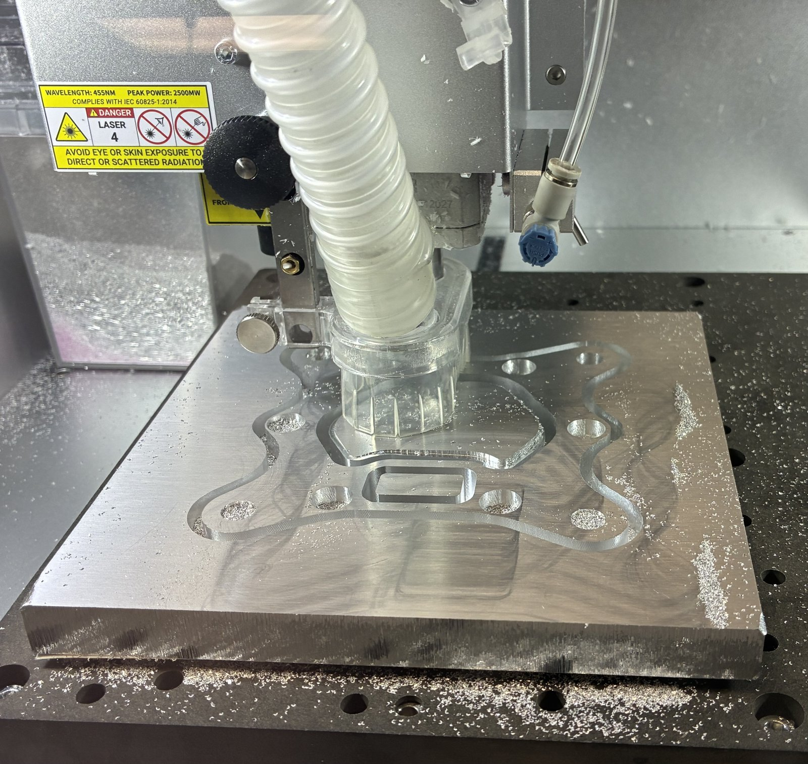
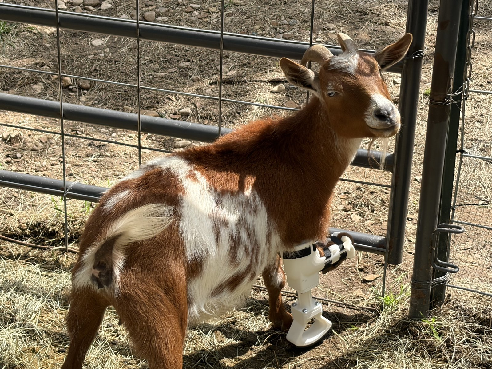
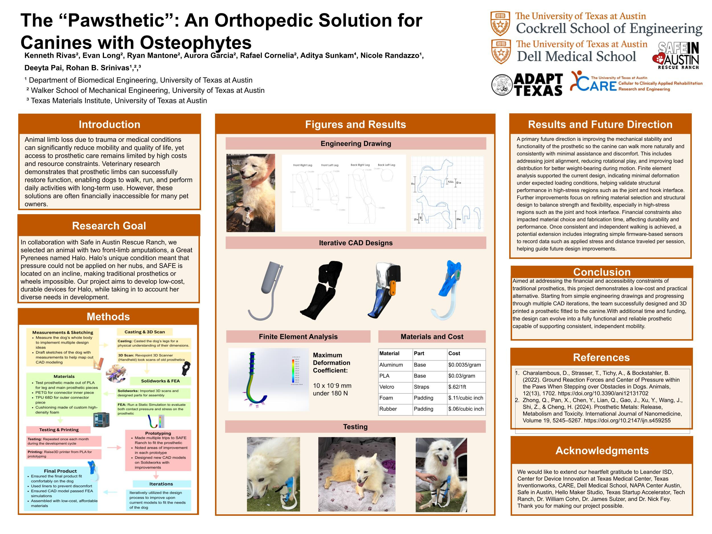

<!--
  Editing this page: this file is plain Markdown. Change any text freely.
  - Each project has three sections: Objective, Method, Results (### headings).
  - A line starting with "- **Title.**" is one bullet.
  -  lines are photos; change the src path to swap a photo.
  - 
 holds two photos shown side by side.
  - Each photo sits in a <figure>. Type its caption between <figcaption> and </figcaption>;
    an empty figcaption shows nothing on the page.
  - Keep the <h2 id="..."> lines as they are: the jump buttons at the top use them.
-->

<h2 id="trel">Texas Rocket Engineering Lab (TREL)</h2>

<figure>

<figcaption>Lifting Halcyon onto GSE</figcaption>
</figure>
<figure>

<figcaption>Staging LOx, RP-1, and GN2 ground systems for testing</figcaption>
</figure>

### Objective

From January 2024 I designed, built, and tested the ground fluid systems for TREL's Halcyon rocket, covering LOx, RP-1, GN₂, GHe, GH₂, GOx, and water. In my second semester I became Ground Fluids Responsible Engineer, owning the P&IDs and integration of nearly all ground-fluid hardware onto a mobile ground station. After that was operational I moved to a more test-focused role, developing test stands and assisting the validation of on-rocket hardware.  

<figure>

<figcaption>Generic P&amp;ID Example: source<a href="https://doi.org/10.1007/978-3-030-89887-8_2" target="_blank" rel="noopener">https://doi.org/10.1007/978-3-030-89887-8_2</a></figcaption>
</figure>
<figure>

<figcaption>Initial cold flow and COPV fill of LN2</figcaption>
</figure>

### Method

- **Mobile GSE trailer.** Redesigned and integrated the LOx, RP-1, nitrogen, hydrogen, oxygen, helium, and water subsystems onto one field-deployable trailer, coordinating routing, mounting, maintenance access, and safety with the structures, electronics, software, and propulsion teams.
- **FireX fire suppression.** Designed a water-based engine-bay suppression system from scratch: architecture, tank selection, line routing, tube sizing, and nozzles for broad coverage plus targeted ignition points, then built it.
- **LOx
- **Fluid Flow test Stands**
- hydrocart: high-pressure test cart providing water to test articles at up to 10kpsi. it was used to autofrettage and proof test our COPVs. I was the technician and safety coordinator for some of these tests. I set up a blast shield to reduce the harm from any potential fractures, and would set up and perform maintenance on the cart and connections.
- water/gas flow test stand: previously teams had developed water and gas flow stands separately, but wfts was highly inaccurate (used a paddle based flow sensor) and gas flow had been cannibalized to feed other tests. I worked to simplify the water flow system, shortened the total length of it, removed some extraneous hardware, and replaced the flow sensor with a venturi nozzle. the dP sensing element proved to be much more accurate. This test stand was later used to validate the pintle injector. gas flow was used to validate the RCS assembly. 
- **Testing.** COPV proof and autofrettage, strain-gauge installation, and differential-pressure sensor validation on the Water Flow Test Stand, whose valve and orifice section I rebuilt.

### Results

- The trailer became the backbone of cold-flow testing at our Pancake, TX site, and later served as the GSE station for static fires and eventually a launch attempt.
- FireX provided a comforting safety net in the 
- LOx fill automation cut operator workload and made fills repeatable.
- Supported five cold-flow tests.

*Some images come from the lab's public social media due to ITAR restrictions.*

<h2 id="ascend">ASCEND</h2>

<figure>

<figcaption>Current Vehicle Side View</figcaption>
</figure>

### Objective

ASCEND is building an emergency-response aircraft for the GoAero competition. The testbed is a stripped ATV with electric drive, a flight motor, and a paraglider wing, being converted to remote and then autonomous control. I joined in January 2025 with ownership of steering development. In Fall 2025 I became the Production Lead, and lated ascended to the role of Chief Mechanical Engineer in June 2026.

<figure>

<figcaption>Conservative Static Loading FEA on Battery Support Structure</figcaption>
</figure>
<figure>

<figcaption>CNC Machining Air Motor Mount</figcaption>
</figure>

### Method

- **Front frame.** Measured, modeled, and performed FEA our battery frame, tying into into four irregular mounting points on different planes. After verifying the design, I welded the frame together and mounted it. 
- **Flight motor mount.** Built an adjustable 80/20 mount adapting the motor's hex bolt pattern for testing. After determining the position of the motor and cage, I modeled and analysed a welded-steel tube structure with damped mounting points, tying onto a lightweight aluminum motor plate I CNC machined. 
- **Linear actuator integration.** A ground-clearance problem forced us to remount the braking linear actuators higher on the chassis than they were originally placed. I designed and machined the 10 mm aluminum adapter plates to ±0.1mm precision, tight enough to press-fit features on the mounting hardware.
- **Electronic and Soft mounts,** The vehicle makes use of a number of electronic components. I designed and printed parts to hold these electronics and their cables. Additionally, the rising 

### Results

- Every major subsystem was manufactured and physically on the vehicle. 
- The front frame effectively carries the weight and cushions the batteries and main electronics plate, as well as counterbalances the weight of the motor in the rear. 
- Braking improved substantially in testing.
- Each test stand cost under $30.

<h2 id="adapt">ADAPT: animal prosthetics</h2>

<figure>

<figcaption>Evie trying out her prosthetic</figcaption>
</figure>

### Objective

With ADAPT Texas and Safe in Austin Rescue Ranch, our team designed low-cost, 3D-printed prosthetics for two rescue animals: Halo, a Great Pyrenees with two front-limb amputations whose residual limbs could not bear pressure, on a ranch built on an incline that ruled out wheels; and a goat in need of a hoof prosthesis.

<figure>

<figcaption>Static loading FEA analysis of Halo's aluminum blade</figcaption>
</figure>
<figure>

<figcaption>Research Paper for Halo's "Pawsthetic", presented at CARE Research Day. </figcaption>
</figure>

### Method

- **"Pawsthetic" for Halo.** We cast and 3D-scanned her legs, iterated in SolidWorks, and refit PLA, PETG, and TPU prototypes at the ranch monthly.
- **Goat hoof prosthesis.** Took anatomical measurements and iterated the CAD to fix early balance and dragging problems.

### Results

- **Halo's blade:** FEA showed about 10×10⁻⁹ mm maximum deformation under 180 N.
- **Goat hoof:** SolidWorks FEA validated the design at 6.07×10⁻⁷ mm under 180 N. Next steps were a molded rubber tread and a machined pyramid connector so parts can be swapped.

<!-- Add a line here about what you personally did on ADAPT, e.g. "- **My role.** ..." -->
