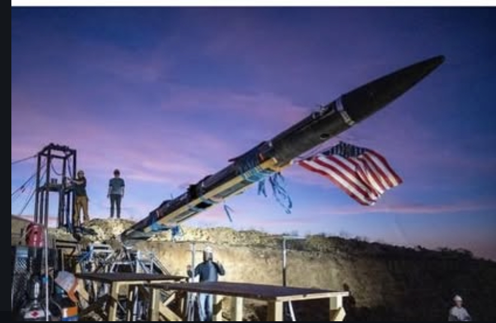
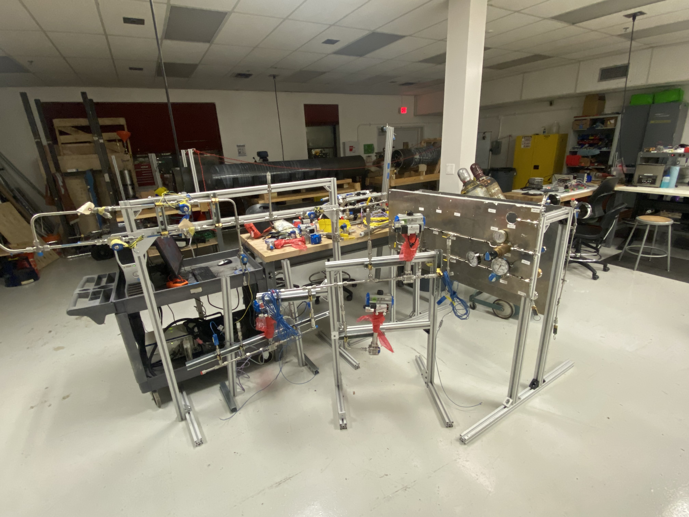
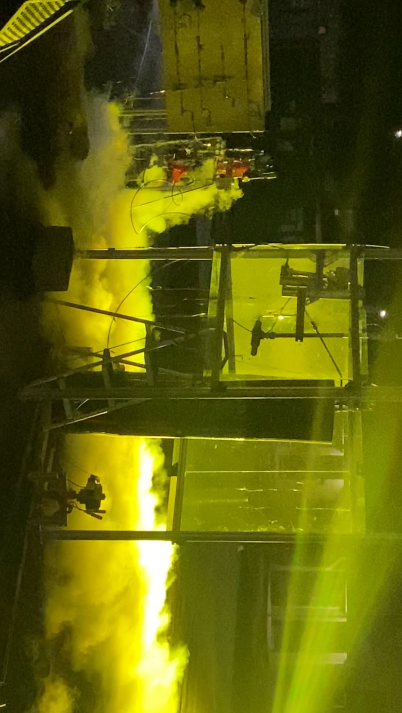
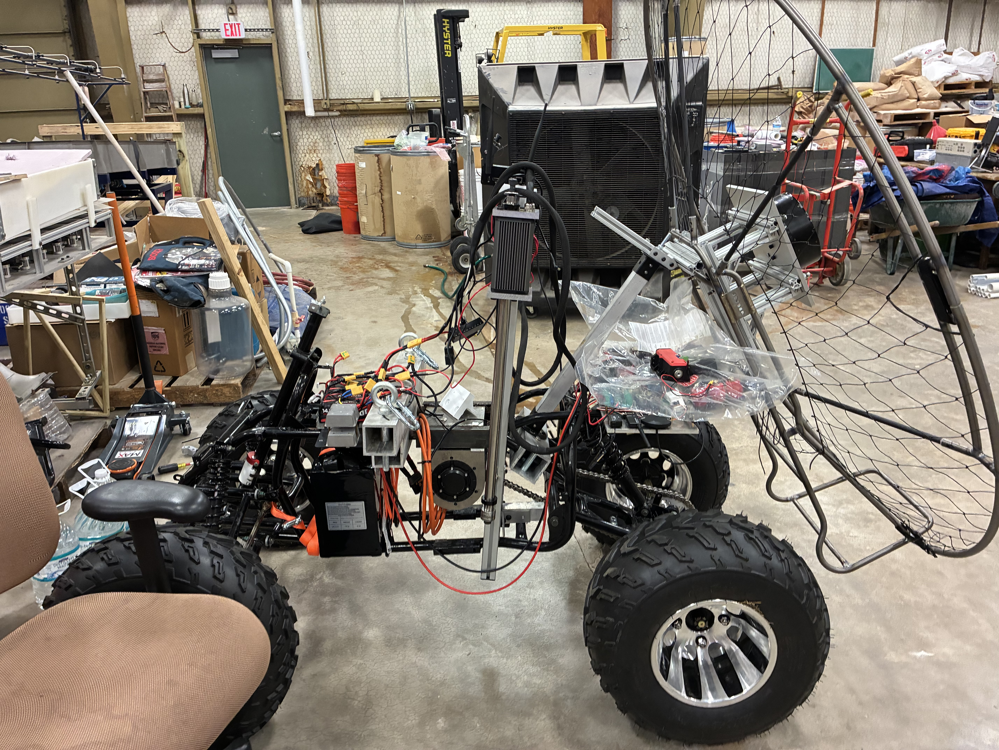
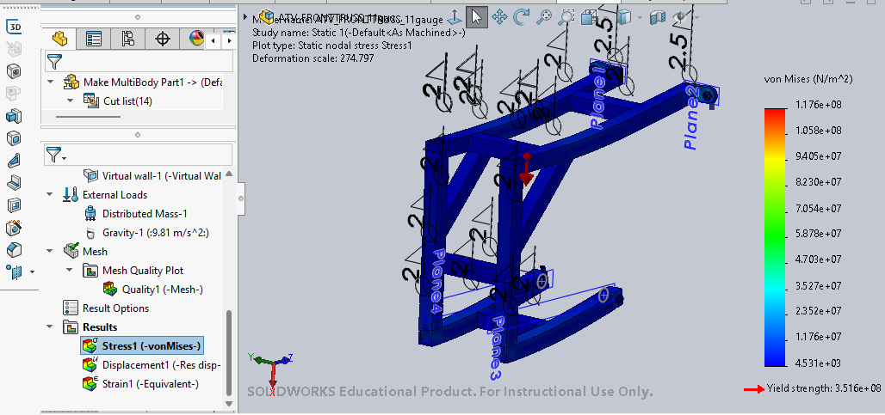
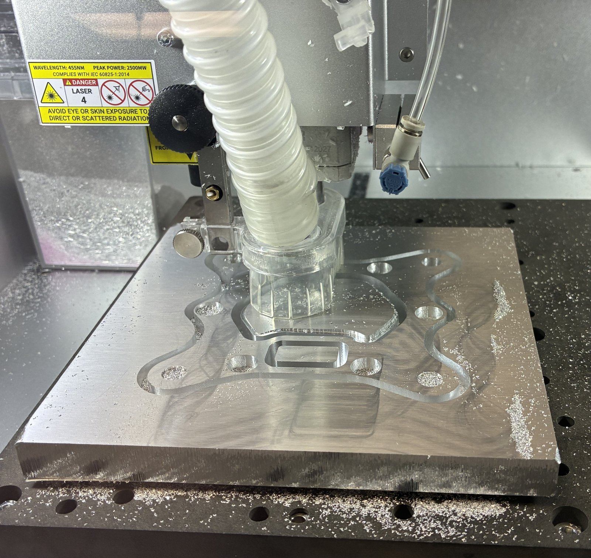
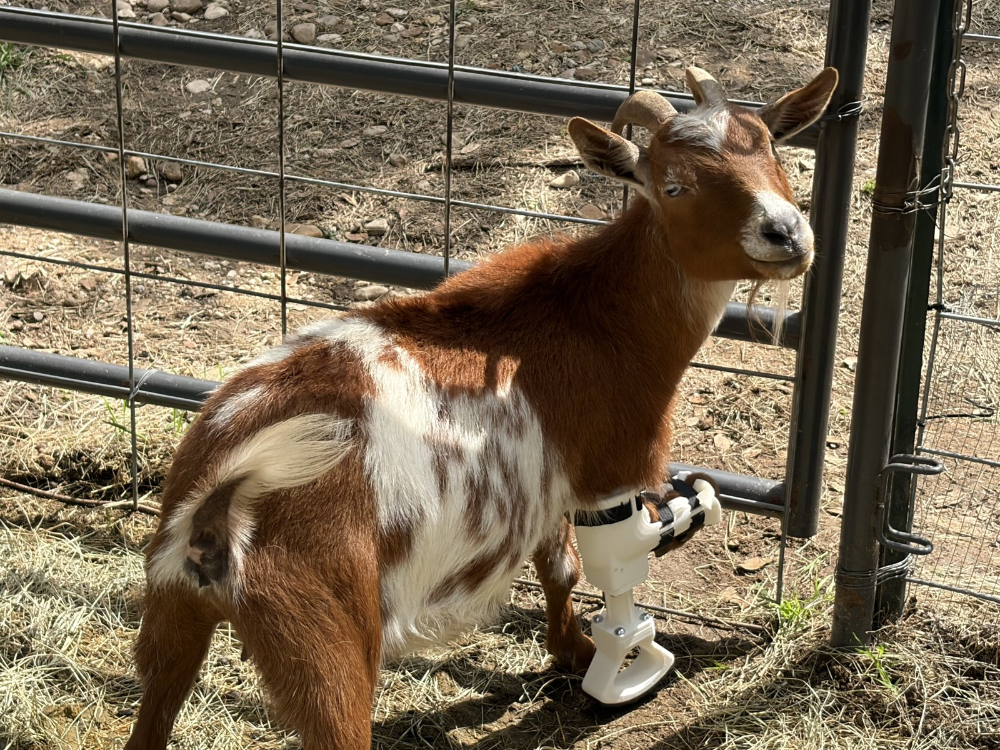
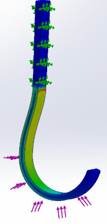
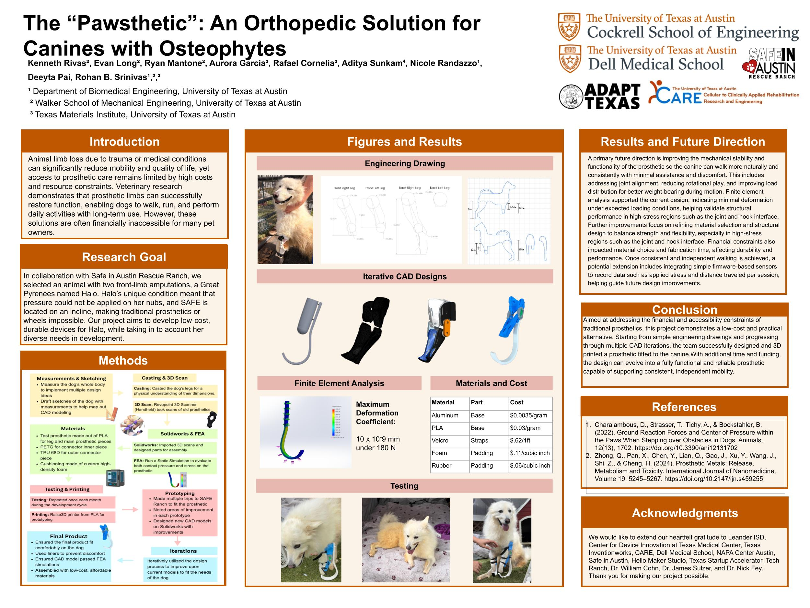

<!--
  Editing this page: this file is plain Markdown. Change any text freely.
  - Each project has three sections: Objective, Method, Results (### headings).
  - A line starting with "- **Title.**" is one bullet.
  -  lines are photos; change the src path to swap a photo.
  - 
 holds two photos shown side by side.
  - Keep the <h2 id="..."> lines as they are: the jump buttons at the top use them.
-->

<h2 id="trel">Texas Rocket Engineering Lab (TREL)</h2>

### Objective

From January 2024 I designed, built, and tested the ground fluid systems for TREL's Halcyon rocket, covering LOx, RP-1, GN₂, helium, GH₂, GOx, and water. In my second semester I became Ground Fluids Responsible Engineer, owning the P&IDs and integration of nearly all ground-fluid hardware.

### Method

- **Mobile GSE trailer.** Redesigned and integrated the LOx, RP-1, nitrogen, hydrogen, oxygen, helium, and water subsystems onto one field-deployable trailer, coordinating routing, mounting, maintenance access, and safety with the structures, electronics, software, and propulsion teams.
- **FireX fire suppression.** Designed a water-based engine-bay suppression system from a blank page: architecture, tank selection, line routing, tube sizing, and nozzles for broad coverage plus targeted ignition points, then built it.
- **LOx fill automation.** Wrote a state-machine controller running a bang-bang valve strategy to hold tank pressure inside its band during filling.
- **Igniter and purge systems.** Helped lead the GH₂/GOx igniter feed systems with electronically controlled regulators, and designed a continuous GN₂ purge that keeps electronics enclosures free of hazardous gas.
- **Testing.** COPV proof and autofrettage, strain-gauge installation, and differential-pressure sensor validation on the Water Flow Test Stand, whose valve and orifice section I rebuilt.

### Results

- The trailer became the backbone of cold-flow testing at our Pancake, TX site, and later served as the GSE station for static fires and eventually a launch attempt.
- FireX was later verified through tests.
- LOx fill automation cut operator workload and made fills repeatable.
- Supported five cold-flow tests.

*Some images come from the lab's public social media because of ITAR restrictions.*

<h2 id="ascend">ASCEND</h2>

### Objective

ASCEND is building an emergency-response aircraft for the GoAero competition. The testbed is a stripped ATV with electric drive, a flight motor, and a paraglider wing, being converted to remote and then autonomous control. I joined in January 2025 and became Chief Engineer in June 2026.

### Method

- **Front frame.** Measured, modeled, and ran FEA on a frame tying into four irregular mounting points on different planes, then sourced material and welded it.
- **Flight motor mount.** Built an adjustable 80/20 mount adapting the motor's hex bolt pattern for stand testing. When a later version vibrated, I redesigned it with stiffer members and damping hardware.
- **Linear actuator integration.** A ground-clearance problem forced a move from custom parts to an aluminum frame reinforced with 40×40 channel. I designed and machined the 10 mm aluminum adapter plates, with press-fit features for vibration resistance.
- **Braking system.** Designed an adapter that fit an off-the-shelf replacement brake to the originally unusable system, with provisions for future linear-actuator control.
- **Test stands.** Designed and built two stands from hardware-store material: one for flight-motor and wing-mount tests, one that places the actuators in their on-vehicle geometry for brake testing.

### Results

- The concept earned a GoAero Innovation Award, and by June 2026 every major subsystem was physically on the vehicle.
- The front frame is simple, cheap, and rigid, and carries the batteries and electronics.
- The vehicle later adopted the same adjustable mount approach used for stand testing.
- Braking improved substantially in testing.
- Each test stand cost under $30.

<h2 id="adapt">ADAPT: animal prosthetics</h2>

### Objective

With ADAPT Texas and Safe in Austin Rescue Ranch, our team designed low-cost, 3D-printed prosthetics for two rescue animals: Halo, a Great Pyrenees with two front-limb amputations whose residual limbs could not bear pressure, on a ranch built on an incline that ruled out wheels; and a goat in need of a hoof prosthesis.

### Method

- **"Pawsthetic" for Halo.** We cast and 3D-scanned her legs, iterated in SolidWorks, and refit PLA, PETG, and TPU prototypes at the ranch monthly.
- **Goat hoof prosthesis.** Took anatomical measurements and iterated the CAD to fix early balance and dragging problems.

### Results

- **Halo's blade:** FEA showed about 10×10⁻⁹ mm maximum deformation under 180 N.
- **Goat hoof:** SolidWorks FEA validated the design at 6.07×10⁻⁷ mm under 180 N. Next steps were a molded rubber tread and a machined pyramid connector so parts can be swapped.

<!-- Add a line here about what you personally did on ADAPT, e.g. "- **My role.** ..." -->
