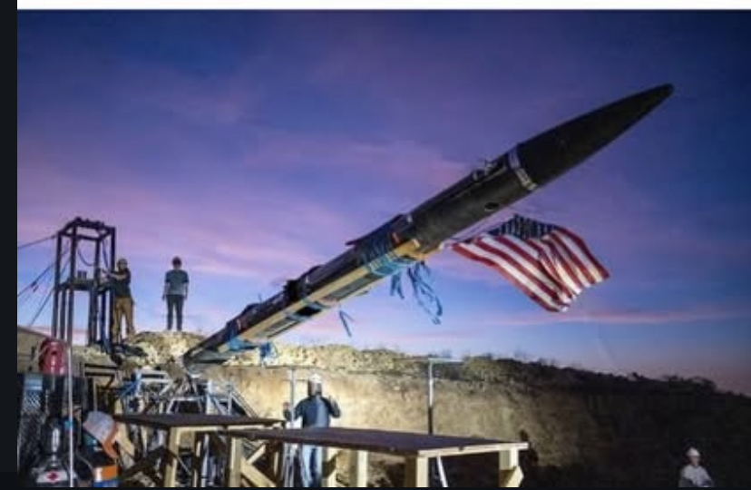
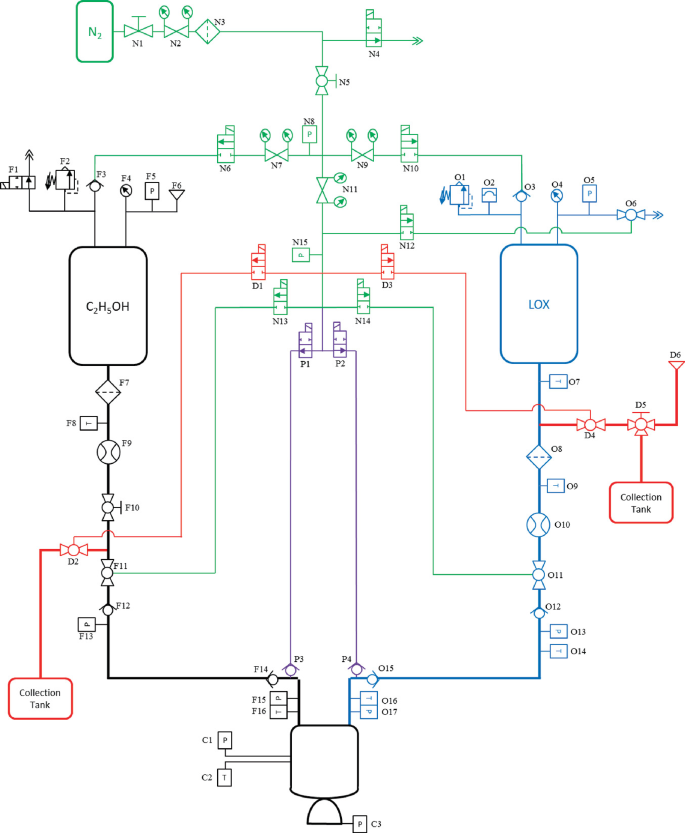
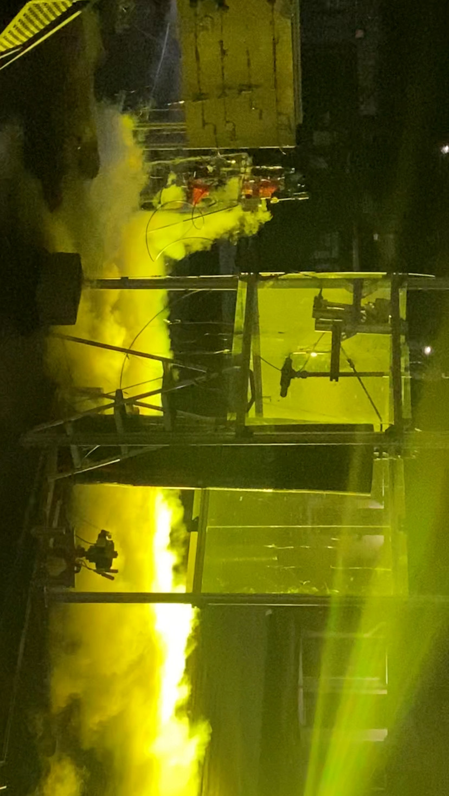
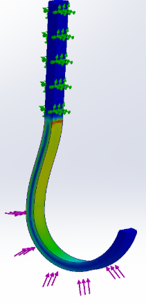

<!--
  Editing this page: this file is plain Markdown. Change any text freely.
  - Each project has three sections: Objective, Method, Results (### headings).
  - A line starting with "- **Title.**" is one bullet.
  -  lines are photos; change the src path to swap a photo.
  - 
 holds two photos shown side by side.
  - Each photo sits in a <figure>. Type its caption between <figcaption> and </figcaption>;
    an empty figcaption shows nothing on the page.
  - Keep the <h2 id="..."> lines as they are: the jump buttons at the top use them.
-->

<h2 id="trel">Texas Rocket Engineering Lab (TREL)</h2>

<figure>

<figcaption>Lifting Halcyon onto GSE</figcaption>
</figure>
<figure>

<figcaption>Staging LOx, RP-1, and GN2 ground systems for testing</figcaption>
</figure>

### Objective

From January 2024 I designed, built, and tested the ground fluid systems for TREL's Halcyon rocket, covering LOx, RP-1, GN₂, GHe, GH₂, GOx, and water. In my second semester I became Ground Fluids Responsible Engineer, owning the P&IDs and integration of nearly all ground-fluid hardware onto a mobile ground station. Once that was operational, I moved into a more test-focused role, developing test stands and helping validate on-rocket hardware.

<figure>

<figcaption>Generic P&amp;ID Example: Ringas, N. (2022). Propellant Feed Assembly Design for a Pressure-Fed 1 kN Liquid Propellant Rocket Engine Test Platform. In: Froehlich, A. (eds) <em>Space Fostering African Societies</em>. Southern Space Studies. Springer, Cham. <a href="https://doi.org/10.1007/978-3-030-89887-8_2" target="_blank" rel="noopener">https://doi.org/10.1007/978-3-030-89887-8_2</a></figcaption>
</figure>
<figure>

<figcaption>Initial cold flow and COPV fill of LN2</figcaption>
</figure>

### Method

- **Mobile GSE trailer.** Redesigned and integrated the LOx, RP-1, nitrogen, hydrogen, oxygen, helium, and water subsystems onto a single field-deployable trailer, coordinating routing, mounting, maintenance access, and safety with the structures, electronics, software, and propulsion teams.
- **FireX fire suppression.** Designed a water-based engine-bay suppression system from scratch: architecture, tank selection, line routing, tube sizing, and nozzles for broad coverage plus targeted ignition points. Then built it.
- **LOx fill automation.** Wrote a state-machine controller that uses bang-bang valve control to hold tank pressure inside its band during fills.
- **Hydrocart.** A high-pressure test cart that supplies water to test articles at up to 10 kpsi, used to autofrettage and proof test our COPVs. I was the technician and safety coordinator for several of these tests: I set up a blast shield in case of a fracture, and handled setup and maintenance of the cart and its connections.
- **Water and gas flow test stand.** The water and gas stands had been developed separately. The Water Flow Test Stand (WFTS) was inaccurate because it relied on a paddle-wheel flow sensor, and the gas stand had been cannibalized to feed other tests. I simplified the water system, shortened it, removed extra hardware, and replaced the flow sensor with a venturi nozzle read by differential-pressure sensing.
- **Instrumentation.** Installed strain gauges and validated differential-pressure sensors.

### Results

- The trailer became the backbone of cold-flow testing at our Pancake, TX site, and later served as the GSE station for static fires and eventually a launch attempt.
- FireX was later verified through testing.
- LOx fill automation cut operator workload and made fills repeatable.
- The hydrocart autofrettaged and proof tested our COPVs.
- The venturi and differential-pressure setup was far more accurate than the paddle sensor. The WFTS later validated the pintle injector, and the gas flow side validated the RCS assembly.
- Supported five cold-flow tests.

*Some images come from the lab's public social media due to ITAR restrictions.*

<h2 id="ascend">ASCEND</h2>

<figure>

<figcaption>Current Vehicle Side View</figcaption>
</figure>

### Objective

ASCEND is building an emergency-response aircraft for the GoAero competition. The testbed is a stripped ATV with electric drive, a flight motor, and a paraglider wing, being converted to remote and then autonomous control. I joined in January 2025 with ownership of steering development. In Fall 2025 I became the Production Lead, and lated ascended to the role of Chief Mechanical Engineer in June 2026.

<figure>

<figcaption>Conservative Static Loading FEA on Battery Support Structure</figcaption>
</figure>
<figure>

<figcaption>CNC Machining Air Motor Mount</figcaption>
</figure>

### Method

- **Front frame.** Measured, modeled, and performed FEA our battery frame, tying into into four irregular mounting points on different planes. After verifying the design, I welded the frame together and mounted it. 
- **Flight motor mount.** Built an adjustable 80/20 mount adapting the motor's hex bolt pattern for testing. After determining the position of the motor and cage, I modeled and analysed a welded-steel tube structure with damped mounting points, tying onto a lightweight aluminum motor plate I CNC machined. 
- **Linear actuator integration.** A ground-clearance problem forced us to remount the braking linear actuators higher on the chassis than they were originally placed. I designed and machined the 10 mm aluminum adapter plates to ±0.1mm precision, tight enough to press-fit features on the mounting hardware.
- **Electronic and Soft mounts,** The vehicle makes use of a number of electronic components. I designed and printed parts to hold these electronics and their cables. Additionally, the rising 

### Results

- Every major subsystem was manufactured and physically on the vehicle. 
- The front frame effectively carries the weight and cushions the batteries and main electronics plate, as well as counterbalances the weight of the motor in the rear. 
- Braking improved substantially in testing.
- Each test stand cost under $30.

<h2 id="adapt">ADAPT: animal prosthetics</h2>

<figure>

<figcaption>Evie trying out her prosthetic</figcaption>
</figure>

### Objective

In my first semester, I served as a manufacturing and analysis specialist with a group dedicated to creating prosthetics for two animals: A deg named Halo, and a goat named Evie. We aimed to provide these two animals with low-cost devices that allowed them to use their lame limbs. Halo has two front legs ending in bone spurs and a rear amputation at the hip, while Evie has a deformed front limb. Later, I became the organizations Technical Director, advising these projects as well as the other four teams in the organization. 

<figure>

<figcaption>Static loading FEA analysis of Halo's aluminum blade</figcaption>
</figure>
<figure>

<figcaption>Research Paper for Halo's "Pawsthetic", presented at CARE Research Day. </figcaption>
</figure>

### Method

- **"Pawsthetic" for Halo.** We took plaster casts of her legs to create an accurate physical model, 3d-scanned the cast using photogrammetry for a 3d model, and designed and 3d-prited an articulating cast to support her front legs without causing pain. Every prototpye was iterated on in SolidWorks after collecting data from each fitting. I selected PETG ad different TPU compounds for their rigidity, outdoor robustness, and ductility (in the case of TPU). for the cast prototypes, and oversaw the analysis and production of the lightweight aluminum blade on the final version.
- **Goat hoof prosthesis.** Analyzed the geometry of the deformed limb using pictures and simple measuring techniques. Developed a similar 3d-printed shell filled with foam to hold her weight, and iterated on different joint and strut angles to determine which best supported Evie throughout her range of motion. 

### Results

- **Halo's helper:** FEA showed a maximum deflection of <1mm, and a maximum Von Mises stress of 40MPa, under 180 N. Both of these well within the limits of 6061-T6. Halo has successfully put her whole weight on the prosthetics. While she does still show signs of discomfort, it Is nowhere near as extreme as what she displayed with her past prosthetic. 
- **Evie's extension:** Evie recently ran on all four limbs for the first time ever! She uses the prosthetic for up to an hour some days, and her caretakers are working with her to develop the muscles needed to carry it longer and more often. I continue to work with this team integrating electronic sensors into the prosthetic to record force data and analyze her movement. 

<!-- Add a line here about what you personally did on ADAPT, e.g. "- **My role.** ..." -->
